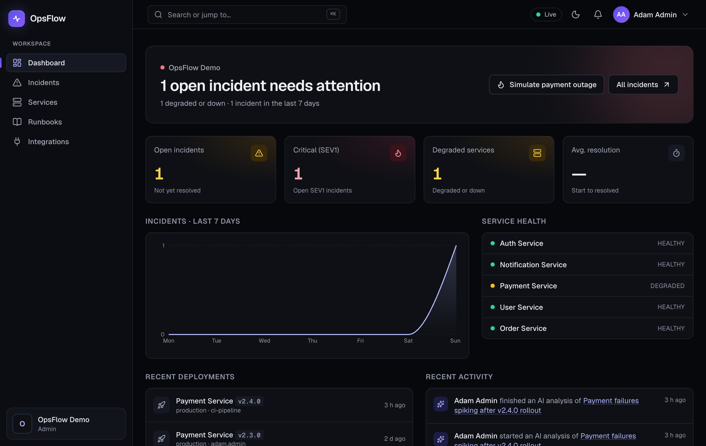
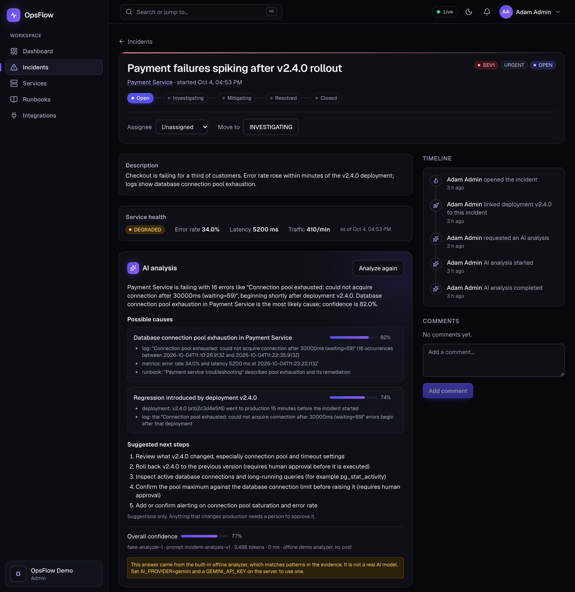
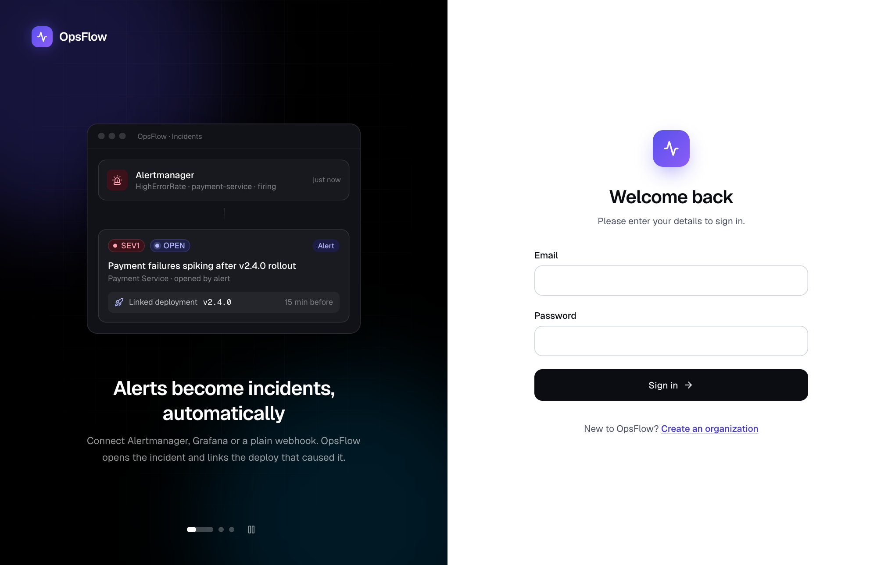
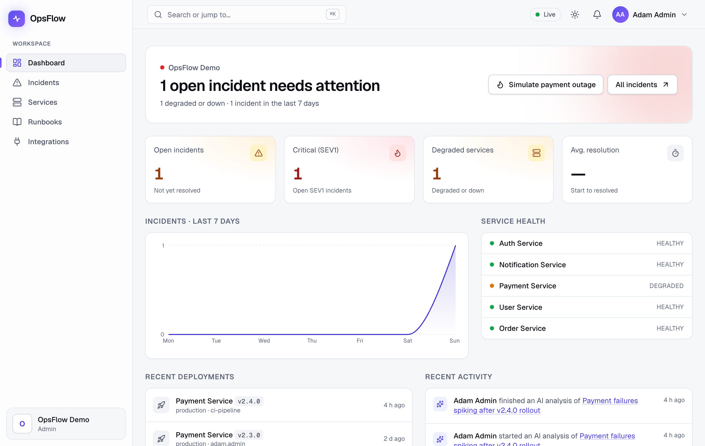
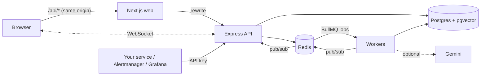

# OpsFlow

[](https://github.com/Akshit171203/OPS-FLOW/actions/workflows/ci.yml)

**Incident management for engineering teams.** When a service breaks, OpsFlow opens the incident, pulls together what changed and what the logs say, suggests likely causes from your own runbooks, and keeps a tamper-evident record of who did what.

Your services connect with an API key and a webhook. A monitoring alert (Alertmanager, Grafana or a plain POST) opens an incident by itself, links the deployments from the last hour, and every open browser updates live.

> **Not deployed yet.** The code, Docker images and a Render Blueprint are ready ([docs/DEPLOYMENT.md](docs/DEPLOYMENT.md)); I have not published a live URL. Run it locally in a few commands below.

## Screenshots



| Incident page                                                                                | Sign-in                                                  | Light theme                                                          |
| -------------------------------------------------------------------------------------------- | -------------------------------------------------------- | -------------------------------------------------------------------- |
|  |  |  |

Dark and light themes follow the system setting, and `Ctrl/Cmd+K` opens a command palette to jump to pages and incidents. The incident above came from **Simulate payment outage** on the seeded demo data; its analysis is from the built-in offline analyzer, which the page labels as such.

## What it does

- **Incidents with a strict lifecycle** (OPEN → INVESTIGATING → MITIGATED → RESOLVED), a timeline of every change, comments, assignees, and optimistic locking so two people cannot silently overwrite each other.
- **Roles** (owner, admin, engineer, viewer) checked on the server, with a full audit log.
- **Real integrations**: API keys (hashed, shown once, scoped, revocable), alert webhooks with de-duplication, deployment and log and metric ingestion. [docs/INTEGRATIONS.md](docs/INTEGRATIONS.md)
- **Live updates** over WebSockets (Socket.IO, fanned out through Redis pub/sub).
- **AI analysis** that reads the incident's logs, deployments and metrics plus your runbooks (pgvector search), and returns causes with confidence and evidence. Asynchronous, optional, and labelled when it is the offline stand-in.
- **Background jobs** (BullMQ) with retries, idempotency and a failed-jobs view.
- **Hardening**: Redis rate limiting, caching, locks, CSRF and CORS, readiness checks, graceful shutdown.
- **A public demo mode**: one click signs a visitor in as a read-only admin, with abuse limits and periodic reset.

## Architecture



Each backend module follows routes → service → repository. A change to an incident, its timeline entry and its audit row are written in one transaction; the domain event is published after commit, so a worker never sees a change that rolled back.

## Run locally

Needs Node 22, pnpm and Docker.

```bash
cp .env.example .env
pnpm install
docker compose up -d      # Postgres (pgvector) and Redis
pnpm db:migrate && pnpm db:seed
pnpm dev:backend & pnpm dev:worker & pnpm dev:frontend
```

Open http://localhost:3140. The seed creates a demo organization; sign in with `demo-admin@opsflow.demo` / `demo-password-1` (also `demo-owner`, `demo-engineer`, `demo-viewer`) and press **Simulate payment outage** on the Incidents page. It creates a believable outage (error logs, degraded metrics, the v2.4.0 deployment) that updates live in every open window.

To run the whole stack as containers (API with embedded workers, and the web app): `docker compose --profile app up --build`.

### Connect a real service

```bash
pnpm demo:shop                                   # a small website that reports to OpsFlow
curl -X POST localhost:5050/admin/deploy-bad     # a bad deploy: within seconds an incident opens by itself
curl -X POST localhost:5050/admin/rollback       # fix it
```

For your own app, create an API key under Integrations and follow [docs/INTEGRATIONS.md](docs/INTEGRATIONS.md).

## Configuration

Full list with comments: [`.env.example`](.env.example) for development and [`.env.production.example`](.env.production.example) for production.

| Variable                    | Purpose                                                      | Default                 |
| --------------------------- | ------------------------------------------------------------ | ----------------------- |
| `DATABASE_URL`, `REDIS_URL` | Postgres 16 with pgvector, and Redis                         | local Compose           |
| `JWT_SECRET`                | Signs sessions, at least 32 characters                       | none (required)         |
| `WEB_ORIGIN`                | Public address of the web app; must be https in production   | `http://localhost:3140` |
| `TRUST_PROXY`               | Reverse proxies in front of the API                          | `1`                     |
| `AI_PROVIDER`               | `fake` (offline) or `gemini`                                 | `fake`                  |
| `GEMINI_API_KEY`            | Server-side only                                             | unset                   |
| `AI_DAILY_CAP`              | New analyses per organization per day (0 disables)           | `200`                   |
| `EMBEDDED_WORKERS`          | Run queue workers inside the API process                     | `false`                 |
| `DEMO_MODE`                 | Public read-only demo sign-in, abuse limits, periodic reseed | `false`                 |
| `API_URL`                   | Web build argument: where `/api/*` is proxied to             | `http://localhost:4100` |

## Tests and checks

```bash
pnpm typecheck && pnpm lint && pnpm test
pnpm --filter @opsflow/frontend check:contrast   # design-token colour pairs meet WCAG AA
```

Backend tests run against the real Postgres and Redis from Compose (database `opsflow_test`), not mocks. They cover tenant isolation, role rules, version conflicts, concurrent alert de-duplication, the job pipeline, rate limits, realtime delivery and the AI pipeline. CI ([`.github/workflows/ci.yml`](.github/workflows/ci.yml)) runs the same checks, builds the app and builds both Docker images.

## API notes

- State-changing requests that use the session cookie must send `X-Requested-With: opsflow` (the web app does this automatically), for example `curl -X POST ... -H 'x-requested-with: opsflow' -H 'cookie: opsflow_token=...'`.
- `GET /health` is liveness; `GET /ready` reports Postgres and Redis (503 if either is down or the process is shutting down).
- Rate limits return `429` with a `Retry-After` header.
- Set `TRUST_PROXY` to the number of reverse proxies in front of the API (1 for the Next.js rewrite), and make sure the API is only reachable through them.

## AI analysis

Press **Analyze with AI** on an incident. By default `AI_PROVIDER=fake` is an offline analyzer that needs no key and says so in the UI. For a real model set `AI_PROVIDER=gemini` and `GEMINI_API_KEY` on the server, then call **POST /api/runbooks/reindex-all** once so runbooks are embedded with the same model. The Gemini path is written and tested against a local stub server that mimics the API's responses and errors, but I have not run it against the live API. If the key is missing the analysis shows a clear failed state and the rest of the app works.

## What I deliberately did not build

- **Monitoring and detection.** OpsFlow responds to alerts; it does not scrape metrics or decide something is wrong. That is Prometheus's and Grafana's job.
- **AI agents that act on production.** Analysis is suggestions only. A model that can restart or roll back needs permissions, approval flows and an audit story that deserve their own project.
- **Paging (phone, SMS), on-call schedules, escalation.** Notifications are in-app. These are the next product features, not a different architecture.
- **Multi-region or high availability.** One Postgres, one Redis. The code is stateless apart from them, so scaling the API horizontally works, but I have not run it that way.
- **Real billing and sign-up flows, SSO, email verification.** Accounts are email and password with argon2.
- **A vector database.** pgvector inside Postgres is plenty for hundreds of runbooks and removes a service to run.

## Documentation

- [docs/DECISIONS.md](docs/DECISIONS.md): why things are the way they are, phase by phase, plus the architecture decision records.
- [docs/DEPLOYMENT.md](docs/DEPLOYMENT.md): Render Blueprint, verification checklist, free-tier limits.
- [docs/INTEGRATIONS.md](docs/INTEGRATIONS.md): connecting your own service.
- [docs/DEMO_SCRIPT.md](docs/DEMO_SCRIPT.md): a two-minute walkthrough.
- [docs/INTERVIEW_PREP.md](docs/INTERVIEW_PREP.md): what to say about this project, and what not to claim.
